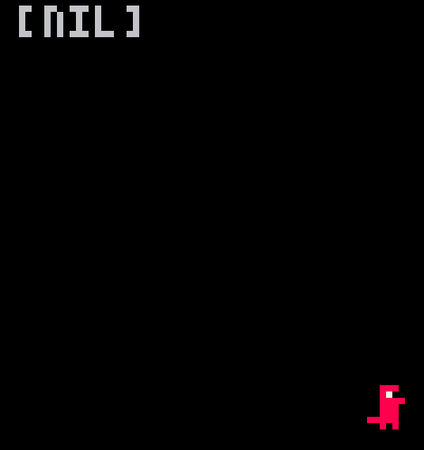

# GAME DESIGN JOURNEY

| # | Entry | Date | Focus |
|:-:|-------|------|-------|
| 1 | [First Work](#first-work) | 22/10/2026 | Basic movement |
| 2 | [Second Work](#second-work) | 22/10/2026 | Maps and player interaction |

---

## First Work:

📅 **22/10/2026**

  * Made a game with very primitive movements (mostly learning how PICO-8 works using the terminal etc.)
  * The game was a red dinosaur that literally just moved around the screen based off Arrow Keys.

  
   
  <em>My first PICO-8 game: Red Dinosaur</em>

### Tutorial used: 
  [SpaceCat's Beginner Tutorial](https://www.youtube.com/watch?v=LTMN5ItzzuA)  

[↑ Back to top](#-game-design-journey)

---

## Second Work: 

📅 **22/10/2026**

  * This game was made to primarily understand the map system of PICO-8.
  * Learnt how to find the position of the player on the map, and based off this change how their character interacts with parts of the map.
  * Learnt to switch between sprites (provide visual queues for changing direction).
  * Found a cheatsheet online.

<table>
  <tr>
    <td align="center">
       
      <em>Car driving on the road</em>
    </td>
    <td align="center">
       
      <em>Car sprite changing direction</em>
    </td>
  </tr>
</table>

  ### What I learnt:
  * Maps has its own editor, and within said editor you make the map using 'parts' that you'd create in the same area that you'd make a sprite. Each 'part' is given its own number (for example '6'), however if you place multiple of the 'parts' it has the same number as one another (i.e. if I placed multiple of the number '6' part they'd all be read as '6' if the player is on it.).

  * I've learnt how to seen when the player / sprite goes onto a specific 'part' that you've made from the sprite editor, through using the 'MGET' command. Because of this, I've managed to make it so the player's speed changed based off what 'part' they're currently on - so I made a car that speeds up on the road, and stops when hitting a red sign.

  * I've also learnt to make bigger sprites (this time a car), as well as switching to other sprites on the press of a button (i.e. the left arrow key displays the sprite moving left, and the right arrow key displays the sprite moving right).

  
<b>PICO-8 cheatsheet (click to expand)</b>

   
  

  ### Tutorials used:
  [SpaceCat's Draw A Map Tutorial](https://www.youtube.com/watch?v=XjpZD4flViE&list=PLavIQQGm3RCmPt93jcg4LEQTvoZRFf9l0&index=4)

  [SpaceCat's Find the Player's Postion Tutorial](https://www.youtube.com/watch?v=1m37s-SssTM&list=PLavIQQGm3RCmPt93jcg4LEQTvoZRFf9l0&index=4)
  
  [SpaceCat's Map Interaction Tutorial](https://www.youtube.com/watch?v=cq11AB6Abaw&list=PLavIQQGm3RCmPt93jcg4LEQTvoZRFf9l0&index=5)

[↑ Back to top](#-game-design-journey)
