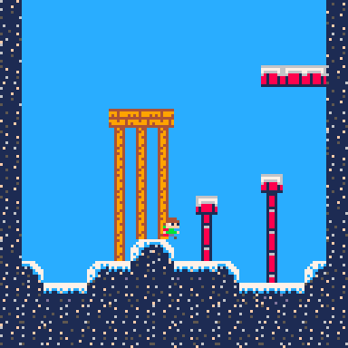

<div align="center">

# PICO-8 Game Design Journey

</div>

<div align="center">
 
| # | Entry | Date | Focus |
|:-:|-------|:----:|-------|
| 1 | [First Work](#first-work) | `22/10/2026` | Basic movement |
| 2 | [Second Work](#second-work) | `22/10/2026` | Maps and player interaction |
| 3 | [Platformer](#third-work) | `23/10/2026 - ?` | Functions and 'physics' |
 
</div>

<br>

---

<details open>
<summary><h2 id="first-work">First Work:</h2></summary>


📅 **22/10/2026**

  * Made a game with very primitive movements (mostly learning how PICO-8 works using the terminal etc.)
  * The game was a red dinosaur that literally just moved around the screen based off Arrow Keys.

<p align="center">
  
  <br>
  <em>My first PICO-8 game: Red Dinosaur</em>
</p>
  <em>My first PICO-8 game: Red Dinosaur</em>
</p>

### Tutorial used: 
>  [SpaceCat's Beginner Tutorial](https://www.youtube.com/watch?v=LTMN5ItzzuA)  

<sub>[↑ Back to top](#pico-8-game-design-journey)</sub>

</details>

---

<details open>
<summary><h2 id="second-work">Second Work:</h2></summary>


📅 **22/10/2026**

  * This game was made to primarily understand the map system of PICO-8.
  * Learnt how to find the position of the player on the map, and based off this change how their character interacts with parts of the map.
  * Learnt to switch between sprites (provide visual cues for changing direction).
  * Found a cheatsheet online.


<table align="center">
  <tr>
    <td align="center">
      <br>
      <em>Car driving on the road</em>
    </td>
    <td align="center">
      <br>
      <em>Car sprite changing direction</em>
    </td>
    <td align="center">
      <br>
      <em>Car in motion (GIF)</em>
    </td>
  </tr>
</table>

### What I've learnt:
  * Maps has its own editor, and within said editor you make the map using 'parts' that you'd create in the same area that you'd make a sprite. Each 'part' is given its own number (for example '6'), however if you place multiple of the 'parts' it has the same number as one another (i.e. if I placed multiple of the number '6' part they'd all be read as '6' if the player is on it.).

  * I've learnt how to see when the player / sprite goes onto a specific 'part' that you've made from the sprite editor, through using the `'MGET'` command. Because of this, I've managed to make it so the player's speed changed based off what 'part' they're currently on - so I made a car that speeds up on the road, and stops when hitting a red sign.

  * I've also learnt to make bigger sprites (this time a car), as well as switching to other sprites on the press of a button (i.e. the left arrow key displays the sprite moving left, and the right arrow key displays the sprite moving right).

<details>
  <summary><b>PICO-8 cheatsheet (click to expand)</b></summary>
  <br>
  
</details>


### Tutorials used:
> [SpaceCat's Draw A Map Tutorial](https://www.youtube.com/watch?v=XjpZD4flViE&list=PLavIQQGm3RCmPt93jcg4LEQTvoZRFf9l0&index=4)
>
> [SpaceCat's Find the Player's Position Tutorial](https://www.youtube.com/watch?v=1m37s-SssTM&list=PLavIQQGm3RCmPt93jcg4LEQTvoZRFf9l0&index=4)
>
> [SpaceCat's Map Interaction Tutorial](https://www.youtube.com/watch?v=cq11AB6Abaw&list=PLavIQQGm3RCmPt93jcg4LEQTvoZRFf9l0&index=5)

<sub>[↑ Back to top](#pico-8-game-design-journey)</sub>

</details>

<details open>
<summary><h2 id="third-work">Third Work:</h2></summary>


📅 **23/10/2026 - ?**

* This game is being made to further improve my understanding of object interaction in PICO-8.
* Learned how to make a jumping and falling mechanic.

### Platformer

[](https://<username>.github.io/<repo>/)

**[▶ Play in your browser](https://owenology.github.io/Game-Design-Journey/)**

Controls: ⬅️ ➡️ to move, ❎ (X) to jump.

### What I've Learnt:

#### Code-related
* PICO-8 allows you to make multiple tabs with code on each tab.
* The variables / functions are universal between tabs.
* I've learnt how valuable functions are (they made the main tab so much easier to read).
* I've learnt how valuable Tables are. (I used a table to store the player's variables)
<details><summary><h5>Player Table Example</h5></summary>
	
```lua
	player = {
		sp=1, -- sprite number
		x=59, -- x position
		y=59, -- y position
		w=8, -- sprite width
		h=8, -- sprite height
		flp=false, -- is the sprite flipped (i.e. looking left instead of right)
		dx=0, -- delta x
		dy=0, -- delta y
		max_dx=2, -- max delta x
		max_dy=3, -- max delta y
		acc=0.5, -- acceleration
		boost=4, -- boost (for jumping)
		anim=0, -- for animation frames
		running=false,
		jumping=false,
		sliding=false,
		falling=false,
		landed=false,
	}
```
</details>

#### PICO-8 Physics-related
* ##### In-depth explanation of PICO-8's sprite co-ordinates for collision.

A sprite's `x` and `y` are the pixel position of its **top-left** corner, and `w` and `h` are its size in pixels. So an 8×8 sprite at `x=59, y=59` covers pixels **59 to 66** on both axes. The last pixel is `x+w-1`, not `x+w`. That one-pixel difference is why `collide_map` is full of `-1`s and `+w-1`s.

The map doesn't work in pixels though, it works in **tiles** (each one 8×8 pixels). Before a pixel position can be looked up on the map it has to be divided by 8. For example, pixel 59 becomes `59/8 = 7.375`, which `mget` reads as tile 7 (it ignores the decimal part).

##### The `collide_map` function

`collide_map(obj, aim, flag)` answers one question: **"is the edge of this object that faces `aim` touching a tile marked with this flag?"** It returns `true` or `false`, and that's all it does. It never moves anything.

| Parameter | What it is |
|-----------|------------|
| `obj` | Any table with `x`, `y`, `w` and `h` (for now, `player`) |
| `aim` | Which edge to check: `"left"`, `"right"`, `"up"` or `"down"` |
| `flag` | Which sprite flag (0-7) marks a tile as solid, set in the sprite editor |

<details><summary><h5>collide_map code</h5></summary>

```lua
function collide_map(obj, aim, flag)
	-- obj = table, needs x,y,w,h

	local x=obj.x local y=obj.y
	local w=obj.w local h=obj.h

	local x1=0 local y1=0
	local x2=0 local y2=0

	if aim=="left" then
		x1=x-1 y1=y
		x2=x y2=y+h-1

	elseif aim=="right" then
		x1=x+w-1 y1=y
		x2=x+w y2=y+h-1

	elseif aim=="up" then
		x1=x+1 y1=y-1
		x2=x+w-1 y2=y

	elseif aim=="down" then
		x1=x y1=y+h
		x2=x+w y2=y+h
	end

	-- pixels to tiles
	x1/=8 y1/=8
	x2/=8 y2/=8

	if fget(mget(x1,y1), flag)
	or fget(mget(x1,y2), flag)
	or fget(mget(x2,y1), flag)
	or fget(mget(x2,y2), flag) then
		return true
	else
		return false
	end
end
```
</details>

**How it works, step by step:**

1. **Copy the object's numbers** into local variables (`x`, `y`, `w`, `h`) so the rest of the function is easier to read.
2. **Pick two points based on `aim`.** `(x1,y1)` and `(x2,y2)` are two pixel positions that sit along the edge being checked, one just outside or on the edge and the other at the far end of it.
3. **Convert those pixels to tiles** by dividing by 8.
4. **Look the tiles up and check their flags.** `mget(tx,ty)` returns the sprite number drawn on the map at that tile, then `fget(sprite, flag)` returns `true` if that sprite has the flag switched on. The function checks every combination of the two points (`x1,y1`, `x1,y2`, `x2,y1`, `x2,y2`), so if *any* of them lands on a flagged tile the answer is `true`.

The points used for each direction:

| `aim` | `(x1, y1)` | `(x2, y2)` | What it checks |
|-------|-----------|-----------|----------------|
| `"left"` | `x-1, y` | `x, y+h-1` | The full left edge, plus the pixel just outside it |
| `"right"` | `x+w-1, y` | `x+w, y+h-1` | The full right edge, plus the pixel just outside it |
| `"up"` | `x+1, y-1` | `x+w-1, y` | The top edge (pulled in slightly from the corners), plus the row above |
| `"down"` | `x, y+h` | `x+w, y+h` | The row of pixels just under the feet |

##### How it interacts with the player

* The `player` table is passed in as `obj`. `collide_map` only reads `player.x`, `player.y`, `player.w` and `player.h`, which is why those four values are in the table.
* The function only **reports** a collision. The code in `_update` decides what to do with the answer (stop falling, stop walking into a wall, etc).
* Each direction is checked separately, so the player can be blocked going down but still free to move sideways.

This is roughly how I expect to hook it up for falling and landing (not in my code yet, my `_update` currently only applies gravity, so the player falls straight through the floor):

```lua
function _update()
	player.dy+=gravity

	-- moving down: is there a solid tile under the feet?
	if player.dy>0 then
		if collide_map(player,"down",0) then
			player.dy=0
			player.landed=true
			-- push the player back up so they sit on top of the tile
			player.y-=(player.y+player.h)%8
		end
	end

	player.y+=player.dy
end
```

The `%8` line works because tiles are 8 pixels tall: `(player.y+player.h)%8` is how many pixels the feet have sunk into the tile, so subtracting it puts the player exactly on top.

### Tutorials used:
> [Platformer tutorial video](https://www.youtube.com/watch?v=-hejwsu9A9g)

<sub>[↑ Back to top](#pico-8-game-design-journey)</sub>

</details>
